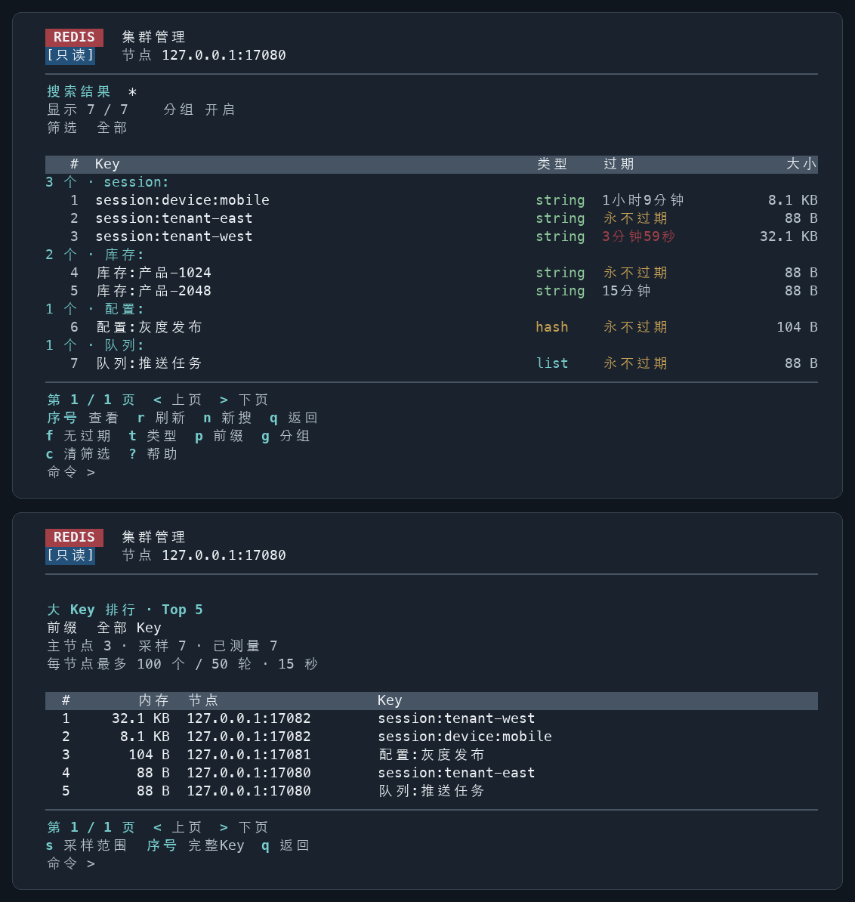

# Redis TUI

[](https://trendshift.io/repositories/381124)

Browse and troubleshoot standalone Redis and Redis Cluster from a read-only-first terminal console. Find keys by prefix, page through collections, and rank memory-heavy keys within a bounded sample. Available for Bash and native Windows PowerShell.

[中文快速上手](#中文快速上手) · [Download Windows ZIP](./redis-tui-powershell.zip?raw=true)



## Quick start

**Windows** · Download and extract the ZIP, then run `redis-tui.cmd`. This launcher uses Windows PowerShell and connects directly to Redis. The terminal prompts are in Chinese.

**Linux, WSL, or macOS** · Install Bash 4+ and `redis-cli`, then run the following. On macOS, use a Bash 4+ installation in place of the system Bash.

```bash
git clone https://github.com/majiajue/redis-tui.git
cd redis-tui
REDIS_CLI="$(command -v redis-cli)" bash bin/redis-tui.sh
```

Enter a standalone or cluster endpoint and credentials at the prompt. The client detects the server mode using `INFO server` or `CLUSTER INFO`. Start with `2` to search for a known prefix, or open `3` → `4` for Big Key Ranking.

### When Python is needed

| Client | Python 3 requirement |
| --- | --- |
| Bash over plain TCP on DB 0 | Optional. Install Python 3 to indent JSON previews. |
| Bash with TLS or a nonzero DB | Required. Python verifies the TLS certificate and confirms the database selection before sending commands. |
| PowerShell | No Python or `redis-cli` installation is needed. The client handles the Redis protocol, TLS, DB selection, and JSON in PowerShell and .NET. |

## Try the demo

Run either command from the repository root. Docker Compose starts a disposable Redis instance, loads the same example data, and opens the selected client. Both demos provide their runtimes inside the containers.

```bash
# Bash
docker compose -f compose.demo.yml run --rm --build tui

# PowerShell
docker compose -f compose.demo.yml run --rm --build powershell
```

Press `1` and open `demo:order:1001` to see the JSON preview. Switch to DB 1 with `6`, then open the same key to see its archived value.

To try the Windows launcher with the sample data, start Redis with `docker compose -f compose.demo.yml run --rm seed`. Launch `redis-tui.cmd`, enter host `127.0.0.1` and port `16380`, and leave the password blank. Set `REDIS_TUI_DEMO_PORT` if that port is in use. Run `docker compose -f compose.demo.yml down` when finished.

## What you can do

| Task | Controls |
| --- | --- |
| Find keys | Use `2` for search, then filter by type or prefix, or show only non-expiring keys. Searches default to 2,000 results and 15 seconds. Press `r` to refresh or `q` to stop a running search. |
| Switch databases | Use `6` on standalone Redis. Lookup, search, ranking, and deletion use the selected DB. A new connection starts at DB 0, and switching DBs restores read-only mode. Redis Cluster uses DB 0. |
| Preview Strings | Open a String to see at most its first 64 KiB. Complete JSON objects and arrays are indented when the client can parse them. |
| Inspect collections | View Hash, Set, List, ZSet and Stream values in pages. Use `<` and `>` to navigate. In a Hash, `f` filters field names by literal text. |
| Investigate high memory use | Open `3` → `4`. Choose one or all primaries and a literal prefix, then set the per-node sample size and Top N. Use `s` to see each node's sample and measurement counts. The rank covers the measured sample. |
| Check server health | Open `3` for an instance or cluster overview, slow queries, and command and error statistics. Monitoring metrics cover the entire instance. |
| Reuse connections | Open `4` for named profiles with ACL usernames and TLS. TLS verifies the certificate name and supports system trust or a custom PEM CA. Passwords are entered at connection time and kept in the running session. |

New sessions start in read-only mode. When deletion is needed, enable writes for the current connection with `5` and `WRITE`. The deletion preview requires a separate `YES` confirmation.

Saved profiles can be opened with `bash bin/redis-tui.sh --profile "name"` or `.\powershell\redis-tui.cmd -Profile "name"`. Set `REDIS_TUI_CONFIG_DIR` to choose a profile directory.

## 中文快速上手

1. Windows 下载并解压 [PowerShell ZIP](./redis-tui-powershell.zip?raw=true)，双击 `redis-tui.cmd`。Linux、WSL 和 macOS 按上方 Bash 命令启动。
2. 输入单机或集群节点、端口和凭据。主菜单 `4` 可切换已保存的连接。单机下按 `6` 切换 DB，切换后自动回到只读。
3. 按 `2` 查 Key。输入结果序号查看详情。集合用 `<`、`>` 翻页，Hash 按 `f` 筛选字段名。String 最多预览前 64 KiB，并支持格式化完整的 JSON 对象和数组。
4. 按 `3` → `4` 查看大 Key 排行。可按主节点和前缀采样，按 `s` 核对覆盖范围和成功测量数。
5. 想用 Docker 一键体验 PowerShell 版，在仓库根目录运行 `docker compose -f compose.demo.yml run --rm --build powershell`。

Bash 版使用 `redis-cli`。开启 TLS、切换到非零 DB 或格式化 JSON 时需要 Python 3。PowerShell 版用 PowerShell 和 .NET 完成这些功能，无需安装 Python 或 `redis-cli`。

集成测试使用 Bash 5.2、PowerShell 7.4 和容器内的 Redis 7.4 单机及集群。Windows PowerShell 5.1 和 WSL 启动器待实机验证。
